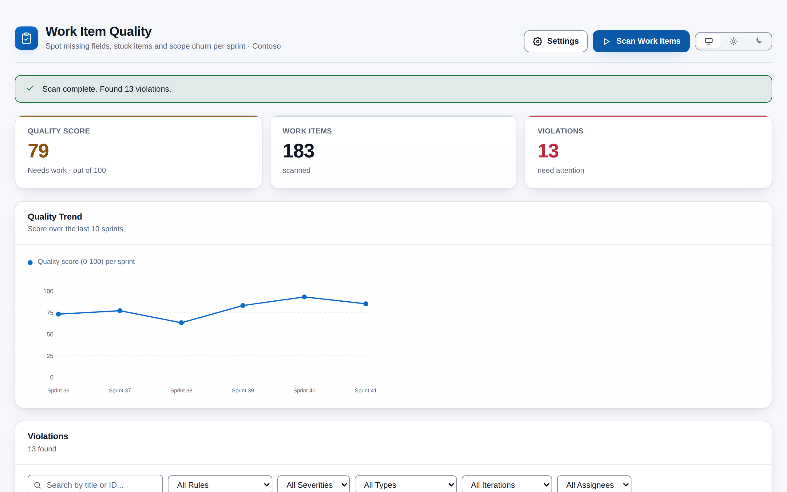
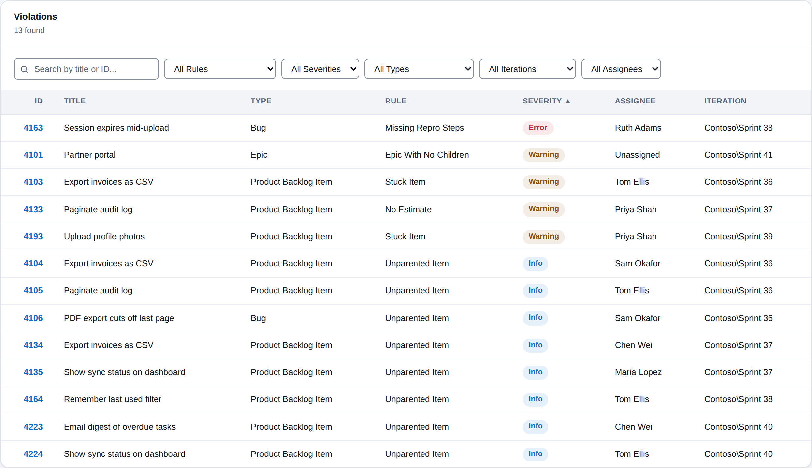
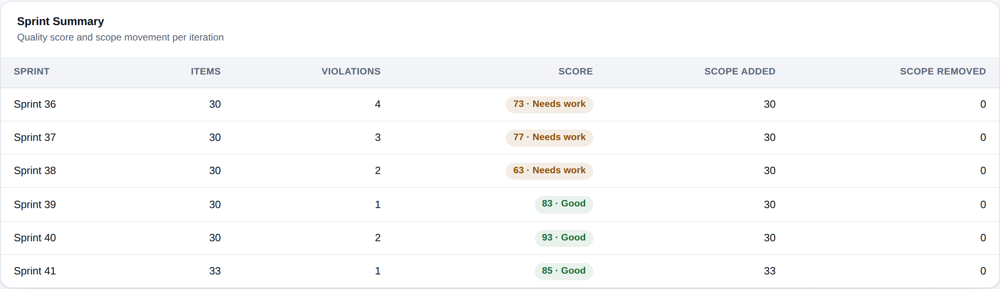
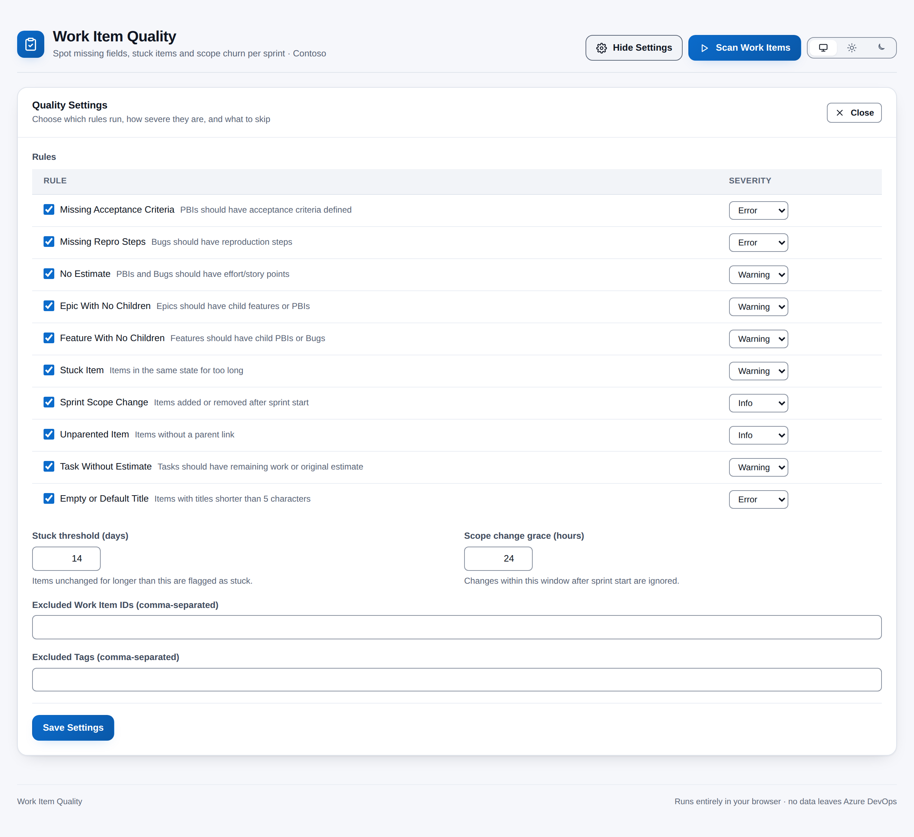

# Work Item Quality Analyzer

[](https://github.com/adam-wheater/azure-devops-work-item-quality/actions/workflows/ci.yml)

An Azure DevOps extension that audits the work items in a project against 10 quality rules: missing acceptance criteria or repro steps, missing estimates, childless epics and features, stuck items, unparented items and placeholder titles. It turns the result into a single 0-100 quality score with per-sprint and per-assignee breakdowns. It is built for Scrum masters, product owners and team leads who want one question answered before planning: *which work items are not ready, and whose are they?* Everything runs in the browser from a hub under **Boards > Work Item Quality**.



## Table of contents

- [Getting started](#getting-started)
- [Features](#features)
- [Screens](#screens)
  - [Header, progress and messages](#header-progress-and-messages)
  - [Quality score card](#quality-score-card)
  - [Quality trend chart](#quality-trend-chart)
  - [Violations table](#violations-table)
  - [Sprint summary](#sprint-summary)
  - [Items needing attention](#items-needing-attention)
  - [Scope changes](#scope-changes)
  - [Quality settings panel](#quality-settings-panel)
- [How it works](#how-it-works)
- [Quality score](#quality-score)
- [Settings](#settings)
- [Rules and detection logic](#rules-and-detection-logic)
- [Scopes & permissions](#scopes--permissions)
- [Privacy](#privacy)
- [Troubleshooting and known limitations](#troubleshooting-and-known-limitations)
- [Development](#development)
- [Project structure](#project-structure)
- [Tech stack](#tech-stack)
- [Contributing](#contributing)
- [License](#license)

## Getting started

1. Install **Work Item Quality Analyzer** by publisher `adam-wheater` from the Visual Studio Marketplace (the listing carries the **Preview** flag).
2. Open a project. The hub is contributed to the **Boards** hub group (`ms.vss-work-web.work-hub-group`, order 99) and appears last in the Boards menu as **Work Item Quality**.
3. On first open, the app loads settings (defaults when none are saved) and shows the project in the subtitle. Nothing is scanned until you press **Scan Work Items**. Results are not cached between visits.
4. Open **Settings** to switch rules or severities, set the stuck threshold and exclusions, then **Save Settings** and scan again. Saved settings apply to everyone in the organisation.

## Features

- **10 quality rules** -- Acceptance criteria, repro steps, estimates, task estimates, children on epics and features, stuck items, parent links, short titles, plus sprint scope tracking.
- **Template-aware empty checks** -- Rich-text fields are stripped of HTML, and placeholder text or untouched template boilerplate counts as empty.
- **Severity per rule** -- Every rule can be switched off or set to Error, Warning or Info.
- **Normalised quality score** -- One 0-100 score, weighted by severity and normalised by the number of items scanned, with a Good / Needs work / Critical label.
- **Filterable violations table** -- Search by title or ID, filter by rule, severity, type, iteration and assignee, and sort by five columns.
- **Sprint summary and trend** -- A score per iteration in natural order ("Sprint 2" before "Sprint 10") and a line chart of the last 10.
- **Assignee breakdown** -- Violations, items and a violation rate per person, worst first.
- **Exclusions** -- Skip work items by ID or by tag (case-insensitive).
- **Cancellable scans** -- **Cancel** stops the scan between WIQL pages and batches.
- **Concurrent, paged fetching** -- WIQL is paged by id to stay under the 20,000-item limit, then details are fetched in batches of 200 with up to 4 requests in flight.
- **Persistent settings** -- Rules, thresholds and exclusions are saved through the Azure DevOps Extension Data Service and merged over the defaults on load.
- **Theme follows Azure DevOps** -- Light, dark and high contrast come from the host's `themeApplied` event, with a header toggle to pin light or dark; the toggle hides under a high-contrast theme or OS forced colours.
- **WCAG AA contrast** -- Both palettes are audited to 4.5:1 for text and 3:1 for UI; scores and severities always carry a text label, never colour alone.

## Screens

### Header, progress and messages

- **Settings** toggles the settings panel (`aria-pressed`) and reads **Hide Settings** while it is open.
- **Scan Work Items** (primary) starts a scan and is replaced by a red **Cancel** button while the scan runs.
- The progress bar is indeterminate and shows the current step: "Starting scan...", "Querying work items...", "Discovered N work items (page p)...", "Found N work items. Fetching details...", "Fetched x / N work items...", "Analyzing quality..." and "Checking sprint scope changes...".
- When the scan finishes, a success banner reads "Scan complete. Found N violations."; a cancelled scan shows an info banner, "Scan cancelled.".
- Errors appear in a dismissible red banner. A settings save that fails reads "Settings were applied to this session but could not be saved: <reason>".
- Results from the previous scan stay on screen until the new scan replaces them.
- A footer reads "Runs entirely in your browser · no data leaves Azure DevOps".

### Quality score card

Shown after a scan.

| Tile | Value | Tone and text |
|------|-------|---------------|
| **Quality Score** | Overall score 0-100 (see [Quality score](#quality-score)). | Success with "Good · out of 100" at >= 80; warn with "Needs work · out of 100" at 60-79; danger with "Critical · out of 100" below 60. |
| **Work Items** | Number of work items fetched. | Neutral, hint "scanned". |
| **Violations** | Number of violations. | Danger with "need attention" when > 0, success with "all clear" when 0. |

The component can show an up / down / flat arrow (with a tooltip such as `up from 72`) when it is given a previous score, but the app does not pass one today, so no arrow is shown.

### Quality trend chart

Shown after a scan. It is titled **Quality Trend**, with the hint "Score over the last 10 sprints" and a legend reading "Quality score (0-100) per sprint".

- It plots the score of the **last 10 entries of the sprint summary**, in natural iteration-path order.
- The y axis is fixed at 0-100, with dashed grid lines at 0, 25, 50, 75 and 100.
- Each point has a tooltip `<sprint>: <score>`. X labels show the sprint name, cut to its last 10 characters.
- The SVG has `role="img"` and an `aria-label`.
- With fewer than 2 sprints it shows "Not enough sprint data for trend chart (need at least 2 sprints)".

### Violations table



Shown when there is at least one violation. The card hint reads `N found`, or `x of N shown` when filters are active.

| Column | Sortable | Content |
|--------|----------|---------|
| **ID** | Yes | Work item id, linked to the work item's `url` (opens in a new tab). |
| **Title** | No | `System.Title`. |
| **Type** | Yes | `System.WorkItemType`. |
| **Rule** | Yes | Rule name; hovering shows the detail, e.g. `Unchanged for 31 days (threshold: 14)`. |
| **Severity** | Yes | Error (danger), Warning (warn) or Info (info) pill with the word on it. |
| **Assignee** | Yes | `System.AssignedTo.displayName` or "Unassigned". |
| **Iteration** | No | Full iteration path. |

**Sorting.** The table is sorted by severity by default, Error first. Severity order is Error, Warning, Info. Clicking a header sorts ascending first; clicking again reverses.

**Filters.**

- A search box matches the title (case-insensitive) or the id (substring).
- Dropdowns filter by **Rule**, **Severity**, **Type**, **Iteration** and **Assignee**; each lists the values present in the results.
- The filters combine with AND.

When no rows match, the table shows "No violations found".

### Sprint summary



Shown when the scan returned work items. One row per iteration path, in natural order.

| Column | Definition |
|--------|------------|
| **Sprint** | Last segment of the iteration path (full path as tooltip). |
| **Items** | Work items whose `System.IterationPath` is this path (including excluded items). |
| **Violations** | Violations on those items. |
| **Score** | `computeScore(violations, items)` as a pill `85 · Good`, toned like the score card. |
| **Scope Added** | Scope-change rows for this path with action "added". |
| **Scope Removed** | Rows with action "removed" (always 0 in this version, see [limitations](#troubleshooting-and-known-limitations)). |

### Items needing attention

One row per assignee display name ("Unassigned" for none), sorted by violations descending, then name.

| Column | Definition |
|--------|------------|
| **Assignee** | Display name. |
| **Violations** | Violations on the person's items. |
| **Items** | Work items assigned to them (including excluded items). |
| **Rate** | `round(violations / items x 100)%`. It can exceed 100 % because one item can break several rules. |

### Scope changes

Shown when the Sprint Scope Change rule is enabled and rows were found.

| Column | Content |
|--------|---------|
| **ID** | Work item id. |
| **Title** | Title. |
| **Action** | "added" (success pill) or "removed" (danger pill). The word is always shown. |
| **Date** | `System.ChangedDate` in the browser locale. |
| **Changed By** | Always "System" in this version. |
| **Sprint** | Iteration path. |

### Quality settings panel



The panel is titled **Quality Settings** and has a **Close** button.

- **Rules.** A table lists all 10 rules. Each row has a checkbox with the rule's name and description, and a severity dropdown (`aria-label="<rule> severity"`) offering Error, Warning and Info.
- **Thresholds.** **Stuck threshold (days)** has a minimum of 1. **Scope change grace (hours)** has a minimum of 0. An empty or out-of-range entry is ignored and the previous value is kept.
- **Exclusions.** **Excluded Work Item IDs** and **Excluded Tags** are comma-separated lists, parsed only when you save. Non-numeric ids and empty tags are dropped.
- **Save Settings.** Applies the settings to the session, writes them to the Extension Data Service and closes the panel. Changes take effect on the **next** scan; the current results are not recomputed.

## How it works

```
   SDK.init() -> SDK.ready() --> ThemeProvider (data-theme / data-contrast) --> <App/>
        |
        |  on load: SettingsService.getSettings()   IProjectPageService.getProject()
        v
   [Scan Work Items]
        |
        v
   WorkItemTrackingRestClient.queryByWiql      (top 19,999, keyset-paged by [System.Id] > last id)
     State NOT IN ('Done','Removed') AND CreatedDate >= 1 Jan of last year
        |
        v
   WorkItemTrackingRestClient.getWorkItems     (200 ids per call, $expand=Relations, 4 concurrent)
        |
        v
   QualityRulesEngine.evaluate  -> violations  -> computeScore
   buildSprintSummaries / buildAssigneeSummaries
        |
        +-- if "Sprint Scope Change" is enabled:
        |     per iteration (4 concurrent): queryByWiql(IterationPath = '...')
        |       -> getWorkItems(200 ids, 4 fields) -> scope change rows
        v
   React cards (Metric, Card, Pill, SortHeader, SVG chart)
        ^
        |  ExtensionDataService: collection "work-item-quality-settings", document "quality-settings"
```

1. **SDK init.** `src/WorkItemQualityHub/WorkItemQualityHub.tsx` runs `SDK.init()` and `SDK.ready()` and renders `<App/>` inside `ThemeProvider`. If the handshake fails, a plain-DOM message ("Work Item Quality could not connect to Azure DevOps. Refresh the page to try again.") and the error text are shown.
2. **Project context and settings.** On load, the app reads the saved settings and asks `IProjectPageService.getProject()` for the project name, which is shown in the subtitle. If the project is unknown, the scan fails with "Could not determine the current project."
3. **Discovery.** `WorkItemDataService.fetchWorkItems` runs a WIQL query for work items in the project that are not in Done or Removed and were created on or after 1 January of the previous calendar year, ordered by id. It asks for up to 19,999 ids per call and repeats with `[System.Id] > <last id>` until a short page comes back.
4. **Details.** Ids are split into batches of 200 and fetched with `getWorkItems` (`$expand = Relations`), at most 4 batches at a time through `ConcurrencyLimiter`.
5. **Cancellation.** The `AbortSignal` is checked before each WIQL page and each batch. A cancelled scan throws `Cancelled` and shows "Scan cancelled.". Requests already in flight finish.
6. **Evaluation.** `QualityRulesEngine.evaluate` skips excluded ids, excluded tags and items in Done or Removed. It then runs each enabled rule whose work item types include the item's type. `computeScore` turns the violations into the overall score, and `buildSprintSummaries` and `buildAssigneeSummaries` produce the roll-ups.
7. **Scope changes.** These run only when the Sprint Scope Change rule is enabled. Each distinct iteration path is queried with WIQL, and the matching items are fetched (Id, Title, IterationPath, ChangedDate) in batches of 200. Batch failures are skipped, and a failure of the whole step leaves the log empty.
8. **Persistence.** Settings live in the Extension Data Service collection `work-item-quality-settings`, document `quality-settings`, in the extension's **Default (collection-wide)** scope: shared by everyone in the organisation, not per user or per project.

## Quality score

```
penalty = 10 x Errors + 5 x Warnings + 1 x Infos
score   = max(0, round(100 - penalty / workItems x 100))      (100 when workItems = 0)
```

The penalty is normalised by the number of work items scanned, so the score reflects the average penalty per item:

| Work items | Violations | Penalty | Score |
|------------|------------|---------|-------|
| 100 | none | 0 | 100 |
| 100 | 1 Error | 10 | 90 |
| 200 | 1 Error + 1 Warning + 1 Info | 16 | 92 |
| 50 | 4 Warnings | 20 | 60 |
| 10 | 1 Error | 10 | 0 |

The denominator is every work item fetched, including excluded items and types no rule applies to. Each sprint row is scored the same way using only that iteration's items and violations.

| Band | Score | Tone | Label |
|------|-------|------|-------|
| Healthy | >= 80 | success | Good |
| Needs attention | >= 60 and < 80 | warn | Needs work |
| Critical | < 60 | danger | Critical |

## Settings

All settings are in one Extension Data Service document: collection `work-item-quality-settings`, id `quality-settings`, Default (collection-wide) scope.

| Setting | Default | Range / validation | Effect |
|---------|---------|--------------------|--------|
| Rule enabled (x 10) | all on | boolean | Disabled rules are not evaluated. |
| Rule severity (x 10) | per rule, see below | Error / Warning / Info; an unknown stored value reverts to the default | Severity of the violations and their weight in the score. |
| **Stuck threshold (days)** | 14 | number >= 1 (UI and on load) | Age of `System.ChangedDate` at which an item is stuck. |
| **Scope change grace (hours)** | 24 | number >= 0 | Saved, but **not used** by the current scope-change logic. |
| **Excluded Work Item IDs** | none | integers | Items skipped by every rule. |
| **Excluded Tags** | none | non-empty strings, matched case-insensitively against `System.Tags` (split on `;`) | Items carrying any of these tags are skipped. |

When settings load, `normalizeSettings` merges the stored rules by id over the current rule list. A rule added in a later release therefore runs with its defaults, and malformed values fall back to the defaults. If the document cannot be read, the defaults are used and nothing is written.

The theme choice is separate: it is kept in browser `localStorage` under `work-item-quality.theme` (`light` or `dark`; absent means follow Azure DevOps).

## Rules and detection logic

Rules apply only to the work item type names listed (Scrum process names). Items in **Done** or **Removed** are never evaluated, and WIQL already excludes them.

| # | Rule (id) | Applies to | Trigger | Default severity |
|---|-----------|-----------|---------|------------------|
| 1 | **Missing Acceptance Criteria** (`missing-acceptance-criteria`) | Product Backlog Item | `Microsoft.VSTS.Common.AcceptanceCriteria` is effectively empty (see below), using the acceptance-criteria template phrases. | Error |
| 2 | **Missing Repro Steps** (`missing-repro-steps`) | Bug | `Microsoft.VSTS.TCM.ReproSteps` is effectively empty, using the bug-template phrases. | Error |
| 3 | **No Estimate** (`no-estimate`) | Product Backlog Item, Bug | Neither `Microsoft.VSTS.Scheduling.Effort` nor `StoryPoints` is set to a non-zero value. | Warning |
| 4 | **Epic With No Children** (`epic-no-children`) | Epic | No `Hierarchy-Forward` relation, and no fetched item has a `Hierarchy-Reverse` relation pointing at it. | Warning |
| 5 | **Feature With No Children** (`feature-no-children`) | Feature | Same check as rule 4 (a child of any type counts). | Warning |
| 6 | **Stuck Item** (`stuck-item`) | PBI, Bug, Task, Epic, Feature | `now - System.ChangedDate >= stuckThresholdDays`, unless the state is Done, Closed, Removed, Completed or Resolved. | Warning |
| 7 | **Sprint Scope Change** (`sprint-scope-change`) | PBI, Bug | Produces **no violation** and does not affect the score. When enabled, it switches on the scope-change fetch that feeds the Scope Changes log and the Scope Added column. | Info |
| 8 | **Unparented Item** (`unparented-item`) | PBI, Bug, Task | No `System.LinkTypes.Hierarchy-Reverse` relation. | Info |
| 9 | **Task Without Estimate** (`task-no-estimate`) | Task | Neither `RemainingWork` nor `OriginalEstimate` is set to a non-zero value. | Warning |
| 10 | **Empty or Default Title** (`empty-title`) | PBI, Bug, Task, Epic, Feature | Trimmed `System.Title` is shorter than 5 characters. | Error |

**"Effectively empty"** (rules 1 and 2) means any of the following:

- The field is missing.
- It is empty after HTML tags are stripped.
- It matches a placeholder pattern: `TBD`, `TODO`, `N/A`, `None`, `Description`, `Enter acceptance criteria here`, `Steps to reproduce:`, `<details>`, `[... placeholder ...]`, or a line of only dashes or dots.
- Removing the known template phrases and separator characters leaves nothing.
  - Acceptance-criteria phrases include "keep the criteria realistic and achievable", "unit tests cc >60", "documentation required", "a11y tests do you have a vpat", "add ids to all ui elements", "lld - created and approved by architects" and "manual test".
  - Bug-template phrases are "steps to reproduce", "actual result", "expected result" and the "when marking bugs as done..." reminder.

Any real text alongside the template counts as content.

**Tuning.** Every rule can be disabled or re-weighted in the settings panel. The stuck threshold is configurable. Exclude individual items by id, or whole groups by tag. Type lists, terminal states, template phrases and the 5-character title limit are fixed in `src/models/interfaces.ts` and `src/analysis/QualityRulesEngine.ts`.

## Scopes & permissions

| Scope | API calls that need it |
|-------|------------------------|
| `vso.work` | `WorkItemTrackingRestClient.queryByWiql` (discovery and per-iteration scope queries) and `WorkItemTrackingRestClient.getWorkItems` (details with relations, and scope-change fields). Read only. |
| `vso.extension.data` | `IExtensionDataManager.getDocument` / `setDocument` for the settings document. |
| `vso.project` | No REST call needs it directly: the project name comes from the host `IProjectPageService`, and the WIQL is project-scoped. It is requested conservatively. |

The extension never writes to work items.

## Privacy

Everything runs in the browser inside the Azure DevOps extension iframe. Work items are read from your organisation's Azure DevOps REST API and never leave it. There is no backend, no telemetry and no call to any third-party host, and the extension never modifies work items.

| Data | Where | Scope |
|------|-------|-------|
| Rule enabled / severity list, `stuckThresholdDays`, `excludedWorkItemIds`, `excludedTags`, `scopeChangeGraceHours` | Extension Data Service, collection `work-item-quality-settings`, document `quality-settings` | Default scope: shared across the organisation |
| Pinned theme (`light` / `dark`) | Browser `localStorage`, key `work-item-quality.theme` | This browser only |

Scan results stay in memory and are discarded when you leave the page.

## Troubleshooting and known limitations

- **Scope change detection is a placeholder.** `fetchScopeChanges` lists every item currently in each iteration as "added", with `ChangedDate` as the date and "System" as the author. It does not compare against the sprint start date or read revision history. As a result, **Scope Removed** is always 0 and the **Scope change grace (hours)** setting has no effect.
- **Process templates other than Scrum are mostly unchecked.** Rules match the type names "Product Backlog Item", "Bug", "Task", "Epic" and "Feature". Agile **User Story**, CMMI **Requirement** and Basic **Issue** items are fetched and count toward the score denominator, but no rule evaluates them.
- **Only recent, open items are scanned.** WIQL excludes Done and Removed, and items created before 1 January of the previous calendar year. Closed and Resolved items are still evaluated for every rule except Stuck.
- **"Stuck" means unchanged, not "same state".** Any field edit resets `System.ChangedDate`.
- **Zero counts as no estimate.** An Effort, Story Points, Remaining Work or Original Estimate of 0 is treated as missing, so a finished task with 0 remaining work and no original estimate is flagged.
- **HTML entities are not decoded.** Acceptance criteria or repro steps containing only `&nbsp;` are treated as filled in.
- **Children are found only within the scanned set.** A reverse link from a child that was not fetched (Done, Removed or too old) does not count, though a forward link on the parent does.
- **The score denominator includes everything fetched**, including excluded items and types no rule applies to. Large projects with many such items score higher than their checked items alone would.
- **No trend arrow on the score.** The component supports one, but the app never passes a previous score.
- **The trend chart uses the last 10 sprint-summary rows in natural path order.** These may include the project root path or areas outside your current cadence.
- **The ID link uses the work item `url` from the REST payload.** That may be the REST resource URL rather than the web form, depending on the server. Unverified against a live organisation.
- **Settings take effect on the next scan.** Saving does not re-evaluate the results on screen.
- **Settings opened before they finish loading show the defaults.** Saving at that moment overwrites the stored settings with those defaults.
- **Per-iteration scope queries are not paged**, so an iteration with more than 19,999 items is truncated.
- **Cancel does not abort in-flight requests.** It stops new ones; previous results stay visible.
- **Settings are organisation-wide.** The document is in the Default (collection-wide) scope, so one user's Save changes the rules for everyone.
- **High-contrast detection is a heuristic**, triggered by pure black and white host colours or by OS forced colours.
- **"Could not determine the current project."** means the hub was opened outside a project.
- **"Work Item Quality could not connect to Azure DevOps."** means `SDK.init()` failed; refresh the page.
- **Re-consent.** If a future version changes the requested scopes, organisation administrators must re-authorise the extension in **Organization settings > Extensions**.

## Development

### Prerequisites

- Node.js 20 or later (`engines.node >= 20`) and npm.
- Install with `npm ci --legacy-peer-deps` (or `npm install --legacy-peer-deps`). The flag is required because of the Azure DevOps SDK and React 18 peer ranges, and CI uses it too.

### npm scripts

| Script | What it does |
|--------|--------------|
| `npm run build` | Production webpack build into `dist/`; `postbuild` runs `scripts/verify-bundle.js`, then `scripts/third-party-notices.js`. |
| `npm run build:dev` | Development build with source maps (CSS still extracted to a file). |
| `npm run screenshots` | Builds the hub on sample data and saves the screenshots to `static/screenshots/` (see below). |
| `npm run verify:bundle` | Re-checks an existing `dist/` without rebuilding. |
| `npm run package` | `tfx extension create` -> `out/*.vsix`. |
| `npm test` | Jest, all projects, verbose. |
| `npm run lint` / `npm run lint:fix` | ESLint 9 flat config over `src/` and `tests/`. |
| `npm run format` / `npm run format:check` | Prettier over `src/**/*.{ts,tsx,css}` and `tests/**/*.{ts,tsx}`. |
| `npm run publish:marketplace` | `tfx extension publish` with `vss-extension.json`. |

### Run it locally with sample data

`demo/` builds the real hub against stand-ins for the Azure DevOps SDK and REST clients, filled with a fictional "Contoso" project. Use it to try the UI without an organisation, and to refresh the screenshots:

```sh
npm i --no-save playwright && npx playwright install chromium   # once
npm run screenshots
```

After that, open `demo/dist/WorkItemQualityHub/WorkItemQualityHub.html` in a browser to click around. `demo/api.ts` holds the sample data and `demo/shots.json` lists the screenshots; the other files in `demo/` are the same in every extension. Nothing in `demo/` ships in the package.

### `build.ps1`

`build.ps1` is the same script in every extension repository (it reads the product name from `vss-extension.json`) and runs the CI steps locally, in CI order:

1. `npm ci --legacy-peer-deps` (the same install as `ci.yml`).
2. `npm run lint` and `npm run format:check`.
3. `npm test`.
4. Bump the version in `vss-extension.json`, `package.json` and both root entries of `package-lock.json` (semver patch +1, e.g. 1.0.9 -> 1.0.10). If any later step fails, all three files are restored.
5. `npm run build` (including `postbuild` bundle verification) and `npm run package`.
6. Check that `out/adam-wheater.<id>-<version>.vsix` exists. If it does not, the script fails instead of reporting an older package.

| Parameter | Effect |
|-----------|--------|
| `-Version 1.1.0` | Release exactly this version instead of the patch bump. |
| `-NoBump` | Package the current version unchanged (cannot be combined with `-Version`). |
| `-SkipInstall` | Reuse the existing `node_modules`. |
| `-SkipTests` | Skip `npm test`. |
| `-SkipChecks` | Skip lint and format check (CI still enforces both). |

The committed version is 1.0.0. `.github/workflows/ci.yml` runs the same install, lint, format check, tests, build, bundle verification and packaging on Node 20, then uploads the `.vsix`.

### Tests

`jest.config.js` defines two projects sharing one `moduleNameMapper` (`@/` alias, CSS -> `styleMock.js`, SDK and API -> `tests/__mocks__`, with a controllable `WorkItemTrackingRestClient` via `__setMockClient`). No coverage threshold is enforced.

- **unit** -- `testEnvironment: node`, everything under `tests/` except `tests/components/`:
  - `QualityRulesEngine`: every rule, template and placeholder handling, score maths, Done / Removed exclusion, disabled rules, configured severity, id and tag exclusions, and type applicability.
  - `summaries`: natural sprint order, per-sprint scores, scope counts and the assignee roll-up.
  - `SettingsService`: `normalizeSettings` merging and fallbacks, a read failure returning defaults without writing, and the fixed document id.
  - `WorkItemDataService`: `escapeWiql`, scope-change batching and abort.
  - `tests/repo/npmScripts.test.ts`: no npm script single-quotes an argument (cmd.exe does not strip single quotes, so such scripts break on Windows); every script `build.ps1` and CI call is defined; `build.ps1` and `ci.yml` both install with `npm ci --legacy-peer-deps`; and `build.ps1` is ASCII-only with no trailing whitespace after a line-continuation backtick. `tests/repo/packageContents.test.ts` asserts that no `.svg` file sits in any path `vss-extension.json` packages, because the Marketplace rejects them.
- **components** -- `testEnvironment: jsdom` with `@testing-library/react`:
  - `QualityScoreCard`: bands at 80 and 60, and trend arrows.
  - `ViolationsTable`: links, severity pills, search, severity filter, sorting and empty states.
  - `QualitySettingsPanel`: list parsing on save, a zero-hour grace period, and rule toggle and severity.

### `scripts/verify-bundle.js`

The script reads `HUB` from `webpack.config.js`. It fails the build if any of these is true:

- the entry page is missing;
- the page references an asset that was not emitted;
- no stylesheet was emitted, or an emitted stylesheet is not linked;
- `<HUB>.js` is not loaded;
- `#root` lacks `class="ax-root"`;
- an inline `<style>` sets padding on `#root`;
- a lazy chunk in the webpack runtime map is missing;
- an emitted script contains an AMD `define(`;
- a `.d.ts` file leaked into `dist/`.

### Design system

- `src/styles/app.css` -- the shared stylesheet: `--ax-*` tokens on `:root`, redefined under `:root[data-theme="dark"]` and mapped to host variables under `:root[data-contrast="high"]`, plus the `.ax-*` component classes (shell, header, cards, metrics, pills, tables, forms, progress, banners, footer).
- `src/components/ui.tsx` -- the primitives: `AppShell`, `ThemeToggle`, `Tabs`, `Button`, `Card`, `Pill`, `Metric`, `Banner`, `Progress`, `Skeleton`, `EmptyState`, `Gate`, `Modal`, `ConfirmDialog`, `Disclosure`, `SortHeader`, `ErrorBoundary` and the inline SVG icons.
- `src/brand.tsx` -- `BRAND` (id, name, tagline) and `BrandGlyph`, the header mark drawn as inline SVG in the bundle. The only packaged icon file is `static/icon.png` (128x128 PNG): the Marketplace rejects `.svg` files in extension packages.

### Theming

The SDK's `init()` writes the host theme as CSS variables on `:root` and dispatches `themeApplied`, on load and on every later change. `ThemeProvider` (`src/utils/theme.ts`) re-reads the variables on that event, on `prefers-color-scheme` and `forced-colors` changes, and on body-class changes. It picks light or dark from the host background's luminance, detects high contrast, and sets `data-theme` and `data-contrast` on `<html>`.

Resolution order is high contrast, then the user's pinned light / dark choice, then the Azure DevOps theme, then the body class, then `prefers-color-scheme`. `useTheme()` returns the palette for the SVG chart. The host page applies the stored choice before the bundle loads, so a dark host never flashes light.

### Accessibility checks applied

- **Contrast:** both palettes meet WCAG 2.1 AA (4.5:1 for text, 3:1 for UI and chart series).
- **Text alongside colour:** scores always show their band label, and severities and scope actions are written on their pills.
- **Labels:** every filter and severity dropdown has an `aria-label`; settings inputs have `<label for>`.
- **Roles and states:** sortable headers expose `aria-sort`; the theme toggle uses `aria-pressed` with screen-reader labels; the chart has `role="img"` and an `aria-label`; error banners are `role="alert"`.
- **CSS:** `:focus-visible`, `prefers-reduced-motion` and `forced-colors` are handled.

## Project structure

```
work-item-quality/
├── src/
│   ├── WorkItemQualityHub/
│   │   ├── WorkItemQualityHub.html      # Host page: links the extracted CSS, stamps stored theme, #root.ax-root
│   │   └── WorkItemQualityHub.tsx       # Entry: SDK.init -> ready -> render <ThemeProvider><App/>
│   ├── analysis/
│   │   ├── QualityRulesEngine.ts        # Rule checks, template/placeholder detection, computeScore
│   │   └── summaries.ts                 # buildSprintSummaries (natural order) and buildAssigneeSummaries
│   ├── brand.tsx                        # BRAND constants and BrandGlyph logo
│   ├── components/
│   │   ├── App.tsx                      # Shell, scan orchestration, banners, card layout, footer
│   │   ├── ui.tsx                       # Shared primitives and icons
│   │   ├── QualityScoreCard.tsx         # Score / items / violations tiles; exports scoreTone, scoreLabel
│   │   ├── QualityTrendChart.tsx        # SVG line chart of the last 10 sprint scores
│   │   ├── ViolationsTable.tsx          # Search, five filters, sortable violations table
│   │   ├── SprintSummaryTable.tsx       # Per-iteration items, violations, score, scope counts
│   │   ├── AssigneeSummary.tsx          # "Items needing attention" by assignee
│   │   ├── ScopeChangeLog.tsx           # Scope change rows
│   │   └── QualitySettings.tsx          # Settings panel; exports parseIdList, parseTagList
│   ├── models/
│   │   └── interfaces.ts                # QUALITY_RULES, types, DEFAULT_QUALITY_SETTINGS
│   ├── services/
│   │   ├── SettingsService.ts           # Data-manager bootstrap (retries), normalizeSettings, load/save
│   │   └── WorkItemDataService.ts       # Paged WIQL, batched getWorkItems, scope changes, escapeWiql
│   ├── styles/
│   │   └── app.css                      # Design system tokens and .ax-* classes
│   └── utils/
│       ├── ConcurrencyLimiter.ts        # Promise concurrency cap (run / map)
│       └── theme.ts                     # Host theme detection, ThemeProvider, useTheme, useThemeMode
├── tests/
│   ├── __mocks__/
│   │   ├── azure-devops-extension-api.ts    # getClient mock, WorkItemTrackingRestClient stub
│   │   ├── azure-devops-extension-sdk.ts    # SDK mock (init, ready, getService, getAccessToken, ...)
│   │   └── styleMock.js                     # Empty module for CSS imports
│   ├── analysis/
│   │   ├── QualityRulesEngine.test.ts       # All rules, scoring, exclusions, severities
│   │   └── summaries.test.ts                # Sprint ordering/scoring/scope counts, assignee roll-up
│   ├── components/
│   │   ├── QualityScoreCard.test.tsx        # Score bands and trend arrows
│   │   ├── QualitySettings.test.tsx         # List parsing, grace 0, rule toggle/severity
│   │   └── ViolationsTable.test.tsx         # Links, pills, search, filter, sort, empty states
│   ├── repo/
│   │   ├── npmScripts.test.ts               # Windows-safe npm scripts, ASCII build.ps1, CI/script install parity
│   │   └── packageContents.test.ts          # No .svg file in any path the manifest packages
│   └── services/
│       ├── SettingsService.test.ts          # normalizeSettings, read-failure defaults, save id
│       └── WorkItemDataService.test.ts      # escapeWiql, scope-change batching and abort
├── demo/                                # Runs the hub on sample data, for screenshots (never shipped)
│   ├── api.ts                           # Sample "Contoso" project behind stand-in REST clients
│   ├── shots.json                       # Which screenshots to take, and the clicks before each
│   └── kit.ts, sdk.ts, shots.js, webpack.config.js   # Same in every extension
├── scripts/
│   ├── third-party-notices.js           # Post-build: dist/THIRD-PARTY-NOTICES.txt from runtime dependencies
│   └── verify-bundle.js                 # Post-build dist/ sanity check
├── static/
│   ├── icon.png                         # Marketplace and hub icon (128x128 PNG; the only icon file, no .svg is packaged)
│   └── screenshots/                     # README and Marketplace screenshots (PNG, from npm run screenshots)
├── .github/workflows/ci.yml             # Install, lint, format, test, build, verify, package
├── LICENSE                              # Proprietary source-available license
├── SECURITY.md                          # How to report a vulnerability privately
├── overview.md                          # Marketplace listing page
├── vss-extension.json                   # Extension manifest (hub, scopes, files)
├── webpack.config.js                    # Entry, CSS extraction, HTML copy, chunk layout
├── tsconfig.json                        # Strict TypeScript, @/ alias, no declarations
├── jest.config.js                       # unit (node) + components (jsdom) projects
├── eslint.config.js                     # ESLint 9 flat config + Prettier
├── .prettierrc.json                     # Prettier rules
├── .vsixignore                          # Files excluded from the .vsix
├── build.ps1                            # Shared build: npm ci, lint, format, test, bump 3 manifests, build, package
└── package.json                         # Scripts and dependencies
```

## Tech stack

| Category | Technology |
|----------|-----------|
| Framework | React 18 (`createRoot`) |
| Language | TypeScript 5, strict mode, ES2020 target |
| Bundler | Webpack 5 with ts-loader, mini-css-extract-plugin, css-minimizer, copy-webpack-plugin |
| Testing | Jest 29, ts-jest, jest-environment-jsdom, @testing-library/react, @testing-library/jest-dom |
| Linting | ESLint 9 flat config, typescript-eslint, Prettier 3 |
| SDK / API | azure-devops-extension-sdk 4.x, azure-devops-extension-api 4.x (Work Item Tracking client, common host services) |
| Charts | Hand-written SVG; no charting library |
| Packaging / CI | tfx-cli, GitHub Actions |

## Contributing

> This project is source-available, not open source. Bug reports and feature requests are
> welcome through GitHub Issues. Code contributions are accepted only by prior written
> agreement; anything you submit is licensed to the project owner under section 4 of the
> LICENSE.

## License

> Copyright © 2026 Adam Wheater. All rights reserved.
>
> This software is provided under a proprietary source-available license: you may read and
> audit the code and use the published extension, but you may not copy, modify, redistribute
> or republish it. See [LICENSE](LICENSE) for the full terms.
>
> Open source components bundled into the extension keep their own licenses. `npm run build`
> writes their notices to `dist/THIRD-PARTY-NOTICES.txt`, which ships inside the package.
