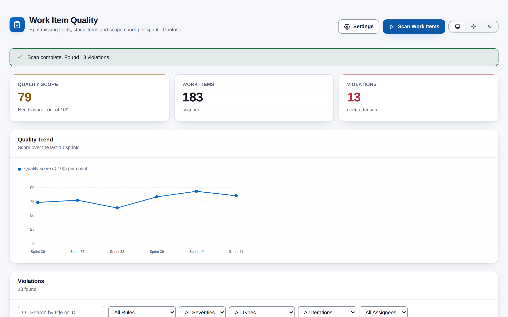
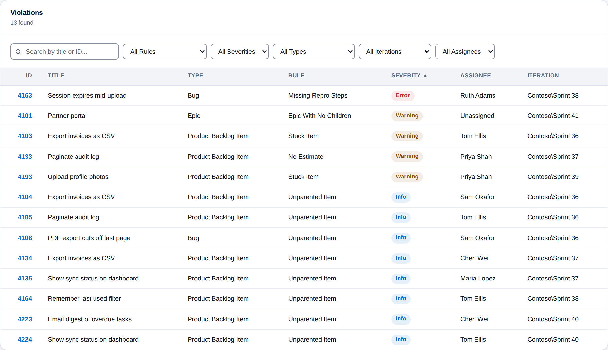

# Work Item Quality Analyzer

**Which work items are not ready, and whose are they?** Work Item Quality Analyzer checks the open work items in your project against ten quality rules and gives you one 0-100 score, broken down by sprint and by person, with every problem listed and filterable. It lives under **Boards > Work Item Quality** and runs entirely in your browser.

## What it checks

| Rule | Applies to | Flags an item when... |
|------|-----------|------------------------|
| Missing Acceptance Criteria | Product Backlog Items | acceptance criteria are empty or only template text |
| Missing Repro Steps | Bugs | repro steps are empty or only the template headings |
| No Estimate | PBIs, Bugs | there is no effort or story points |
| Epic With No Children | Epics | nothing is linked underneath |
| Feature With No Children | Features | nothing is linked underneath |
| Stuck Item | PBIs, Bugs, Tasks, Epics, Features | it has not changed for 14 days (configurable) |
| Unparented Item | PBIs, Bugs, Tasks | it has no parent |
| Task Without Estimate | Tasks | there is no remaining work or original estimate |
| Empty or Default Title | all of the above | the title is shorter than five characters |
| Sprint Scope Change | PBIs, Bugs | lists the items in each sprint in a scope log (informational, no score impact) |

Each rule can be switched off or set to Error, Warning or Info.

## What you get

- **Quality score** -- one number from 0 to 100, weighted by severity and adjusted for the size of the backlog, always labelled Good (80+), Needs work (60-79) or Critical (below 60).
- **Violations table** -- every problem with its work item, rule, severity, assignee and sprint. Search by title or ID, filter by rule, severity, type, sprint or assignee, and sort.
- **Sprint summary and trend** -- a score per sprint and a chart of the last ten.
- **Items needing attention** -- violations per person, worst first.
- **Exclusions** -- skip specific work items by ID, or whole groups by tag.
- **Looks like Azure DevOps** -- follows your light, dark or high-contrast theme, with a toggle to pin light or dark. Scores and severities always carry a label, never colour alone, and both palettes meet WCAG AA contrast.

## How it works

1. Open **Boards > Work Item Quality** and press **Scan Work Items**.
2. The extension queries your project's open work items (created since the start of last year) directly from your organisation's Azure DevOps REST API, in batches, with progress you can cancel.
3. Every item is checked against the enabled rules in your browser, and the score, sprint and assignee breakdowns are calculated.
4. Open **Settings** to choose rules, severities, the stuck threshold and exclusions. Save, and the next scan uses them.

## Permissions, in plain words

- **Work items (read)** -- to run queries and read work item fields and links. The extension never edits a work item.
- **Extension data** -- to remember your rule settings.
- **Project** -- part of the standard permission set; the project is identified from the page you are on.

## Privacy

All analysis happens in the browser inside the Azure DevOps page. Work item data never leaves your Azure DevOps organisation, nothing is sent to any other service, and there is no telemetry. The only things stored are your rule settings (in the Azure DevOps Extension Data Service, shared across your organisation) and your theme preference (in your own browser).

## Requirements

- Azure DevOps Services, or Azure DevOps Server 2020 or later.
- Permission to view work items in the project.
- The rules use the Scrum process work item types (Product Backlog Item, Bug, Task, Feature, Epic).

## Support

Report problems or request features through GitHub Issues: https://github.com/adam-wheater/azure-devops-work-item-quality/issues

## License

Copyright © 2026 Adam Wheater. All rights reserved. This software is provided under a proprietary source-available license: you may read and audit the code and use the published extension, but you may not copy, modify, redistribute or republish it. See the LICENSE file for the full terms. The open source components it bundles keep their own licenses, listed in THIRD-PARTY-NOTICES.txt inside the package.
